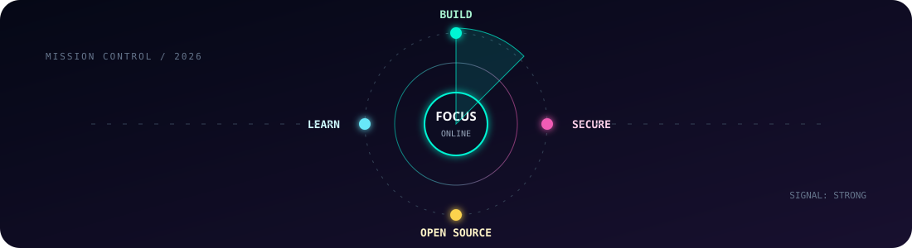
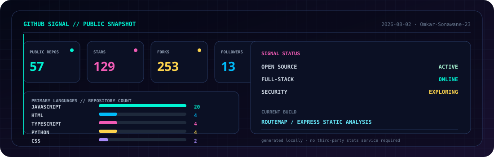

# OMKAR // SONAWANE

### Software Engineer · Full-Stack Developer · Vulnerability Researcher

  
  
  
  

  
  
  

<code>build with intent · secure by design · share what you learn</code>

 
 

<a href="#whoami">WHOAMI</a> ·
<a href="#mission-control">MISSION CONTROL</a> ·
<a href="#featured-builds">FEATURED BUILDS</a> ·
<a href="#stack">STACK</a> ·
<a href="#connect">CONNECT</a>

---

## WHOAMI

> I am a software engineer who likes turning complex ideas into useful, secure, and well-crafted products.

- **Core:** full-stack web development, API design, developer tooling, and security-focused engineering.
- **Curious about:** static analysis, real-time systems, IoT, cybersecurity, and open-source collaboration.
- **Working style:** explore deeply, ship deliberately, document clearly, and keep learning in public.

## MISSION CONTROL

| Signal | Current transmission |
| --- | --- |
| **BUILDING** | [RouteMap](https://github.com/Omkar-Sonawane-23/routemap) — static analysis for Express request lifecycles |
| **EXPLORING** | secure architecture, code quality, developer productivity, real-time collaboration |
| **COLLABORATING** | open source, hackathons, ambitious technical experiments |

## REAL-WORLD SYSTEMS

These are production-oriented systems I helped establish or built independently—not just demos.

<table>
  <tr>
    <td width="50%" valign="top">
      <h3>◈ <a href="https://restoqr.vercel.app/">RestoQR</a></h3>
      
<strong>Solo Founder · Backend / Full-Stack Developer</strong>

      
Built from scratch for Indian restaurants: QR ordering, live kitchen display, counter POS, billing, table settlement, inventory, GST-ready invoicing, and reporting.

      Full-stack · REST APIs · real-time workflows · operations systems
    </td>
    <td width="50%" valign="top">
      <h3>◉ <a href="http://vrstranslink.com/">VRS Translink</a></h3>
      
<strong>Founding Member · Backend Developer</strong>

      
Contributed to the overall establishment of an employee-transportation platform with backend workflows for organizations, drivers, vendors, live tracking, route generation, analytics, and SOS operations.

      MERN · backend systems · logistics · analytics
    </td>
  </tr>
  <tr>
    <td width="50%" valign="top">
      <h3>✦ <a href="https://mendhospitality.in/">Mend Hospitality</a></h3>
      
<strong>Founding Member · Backend Developer</strong>

      
Contributed to the overall establishment of a hospitality workforce platform connecting venues with verified professionals through identity, ratings, shift, and workforce workflows.

      MERN · platform backend · workforce systems
    </td>
    <td width="50%" valign="top">
      <h3>⌁ <a href="http://quibits.vercel.app/">Quibits IT Solutions</a></h3>
      
<strong>Software Engineer</strong>

      
Worked on client-facing software initiatives and contributed across development, implementation, and delivery of web, application, and digital solutions.

      Software engineering · web development · product delivery
    </td>
  </tr>
</table>

> **Pipeline:** More real-world systems are currently in development and will be launching soon.

## FEATURED BUILDS

<table>
  <tr>
    <td width="50%" valign="top">
      <h3>◈ <a href="https://github.com/Omkar-Sonawane-23/routemap">RouteMap</a></h3>
      
Understand an Express application in seconds. Resolves route → middleware → controller → service → repository → database lifecycles and generates documentation, OpenAPI, Postman collections, dependency graphs, and coverage reports.

      <strong>TypeScript</strong> · JavaScript · Express · Static Analysis
    </td>
    <td width="50%" valign="top">
      <h3>◉ <a href="https://github.com/Omkar-Sonawane-23/realtime-code-editor">Codeglimpse+</a></h3>
      
A real-time collaborative code editor with shared rooms, live chat, user presence, multi-language execution, file management, Monaco Editor, and a drawing board.

      <strong>React</strong> · TypeScript · Node.js · Express · Socket.IO
    </td>
  </tr>
  <tr>
    <td width="50%" valign="top">
      <h3>✦ <a href="https://github.com/Omkar-Sonawane-23/VedicVani">VedicVani</a></h3>
      
Full-stack application for serving and exploring Bhagavad Gita content through a React frontend and Node.js backend.

      <strong>React</strong> · Node.js · JavaScript · Python
    </td>
    <td width="50%" valign="top">
      <h3>⌘ <a href="https://github.com/Omkar-Sonawane-23/Maa-Vimala">Maa-Vimala</a></h3>
      
Keyboard-driven browser new-tab productivity tool with quick search, calculations, weather information, and useful shortcuts.

      <strong>JavaScript</strong> · CSS · HTML
    </td>
  </tr>
  <tr>
    <td width="50%" valign="top">
      <h3>△ <a href="https://github.com/Omkar-Sonawane-23/Tourism">Bharat Yatra</a></h3>
      
Tourism application showcasing destinations across India through a fast, modern web experience.

      <strong>React</strong> · Vite · JavaScript · Tailwind CSS
    </td>
    <td width="50%" valign="top">
      <h3>⌁ <a href="https://omkar-sonawane.vercel.app/">Portfolio</a></h3>
      
Personal portfolio exploring software development, vulnerability research, IoT, cybersecurity, and ongoing experiments.

      <strong>Web</strong> · Security · Open Source
    </td>
  </tr>
</table>

## STACK

### Languages

### Build Systems

### Infrastructure & Security

`REST APIs` · `Vulnerability Assessment` · `Secure System Design` · `Cybersecurity` · `Developer Experience`

## EXPERIENCE LOG

| Role | Organization | Period |
| --- | --- | --- |
| **Software Developer** | Quibits IT Solutions | Jul 2024 – Mar 2025 |
| **Professional Freelancer** | Self-employed | Mar 2022 – Present |
| **Technical Team Member** | Ad Astra Official | Feb 2023 – Dec 2024 |
| **Contributor** | GirlScript Summer of Code | May 2023 – Aug 2023 |

## EDUCATION / CERTIFICATIONS

- **Bachelor of Engineering (BE)** — Computer Science & Engineering (IoT & Cyber Security), University of Mumbai
- Introduction to Large Language Models
- Google IT Support Certificate
- Flipkart GRiD 6.0
- Flipkart GRiD 6.0 — Software Development Track

## GITHUB SIGNAL

  

## CONNECT

If you want to talk about software engineering, open source, cybersecurity, developer tools, or a strange idea worth building, reach out.

<a href="https://omkar-sonawane.vercel.app/">PORTFOLIO</a> ·
<a href="https://www.linkedin.com/in/omkarsonawane23">LINKEDIN</a> ·
<a href="https://devfolio.co/@omkarsonawane">DEVFOLIO</a> ·
<a href="mailto:sonawaneomkar2306@gmail.com">EMAIL</a>

 
 

© Omkar Sonawane · keep building things that matter.

